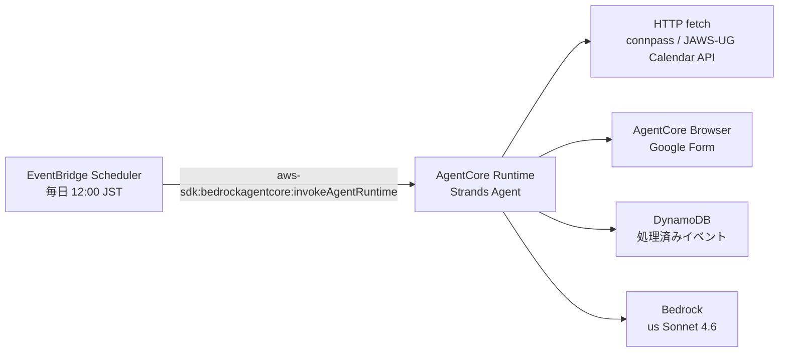

# JAWS-UG 東京イベントカレンダー登録エージェント

JAWS-UG 東京の勉強会を、JAWS-UG のイベントカレンダーへ自動で登録するエージェントです。毎日12時（日本時間）に connpass の直近のイベントを確かめ、これから開かれるのにカレンダーへ載っていないものがあれば、登録用の Google フォームへ送ります。人に呼ばれなくても決まった時刻に自分で動く「アンビエントエージェント」として、Bedrock AgentCore Runtime と Strands Agents で作っています。

公開版は、そのままデプロイしてもフォームを送らず、定期実行も止まった状態で始まります。実際に使うときは、フォームのURLやカレンダーのAPIキーなどを CDK の context で渡して有効にします。フォームの記入者名は、エージェントが代わりに書いたと分かる名前（既定は「みのるん（AgentCoreが代筆）」）にしています。

## 構成

Step Functions は使わない。EventBridge Scheduler の universal target で AgentCore Runtime を直接 invoke する。

## 初回レビュー用モード

- `preview_event`: connpass イベント情報から Google フォームへ入れる値を返す。DynamoDB へ処理済み状態を書かず、フォーム送信もしない。
- `submit_approved_event`: `approved=true` と `FORM_SUBMIT_ENABLED=true` の両方が揃ったときだけ、指定された 1 件のフォームを送信する。

`dry_run` はフォーム送信予定値の確認専用で、DynamoDB に処理済み状態を残さない。

## 公開版の設定

公開リポジトリには実フォームURLと Google Calendar API key は含めない。
デプロイ時に以下の context を指定する。

- `googleFormUrl`
- `jawsugCalendarApiKey`
- `formSubmitEnabled`
- `scheduleState`
- `submitterName`

詳細は [runbooks/deploy.md](runbooks/deploy.md) を参照。
