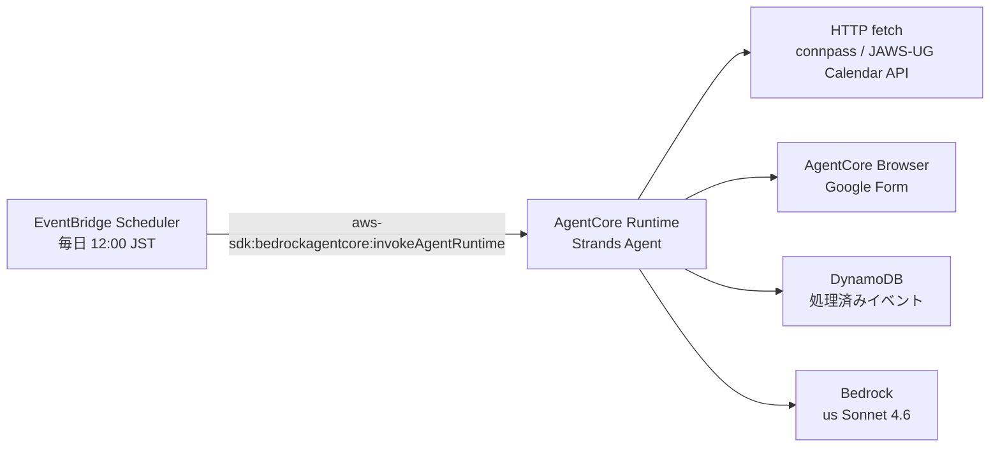

# JAWS-UG 東京イベントカレンダー登録エージェント

JAWS-UG 東京の connpass 直近イベントを毎日 12:00 JST に確認し、未来イベントが JAWS-UG イベントカレンダーへ未登録なら Google フォームへ登録する AgentCore Runtime + Strands Agents のアンビエントエージェント。

公開版のデフォルトは安全側で、`formSubmitEnabled=false` / Scheduler `DISABLED`。
実運用では Google Form URL や Calendar API key などを CDK context で渡す。

記入者氏名は必ず `みのるん（AgentCoreが代筆）` とする。

## 構成

Step Functions は使わない。EventBridge Scheduler の universal target で AgentCore Runtime を直接 invoke する。

## 初回レビュー用モード

- `preview_event`: connpass イベント情報から Google フォームへ入れる値を返す。DynamoDB へ処理済み状態を書かず、フォーム送信もしない。
- `submit_approved_event`: `approved=true` と `FORM_SUBMIT_ENABLED=true` の両方が揃ったときだけ、指定された 1 件のフォームを送信する。

`dry_run` はフォーム送信予定値の確認専用で、DynamoDB に処理済み状態を残さない。

## 公開版の設定

公開リポジトリには実フォームURLと Google Calendar API key は含めない。
デプロイ時に以下の context を指定する。

- `googleFormUrl`
- `jawsugCalendarApiKey`
- `formSubmitEnabled`
- `scheduleState`
- `submitterName`

詳細は [runbooks/deploy.md](runbooks/deploy.md) を参照。
